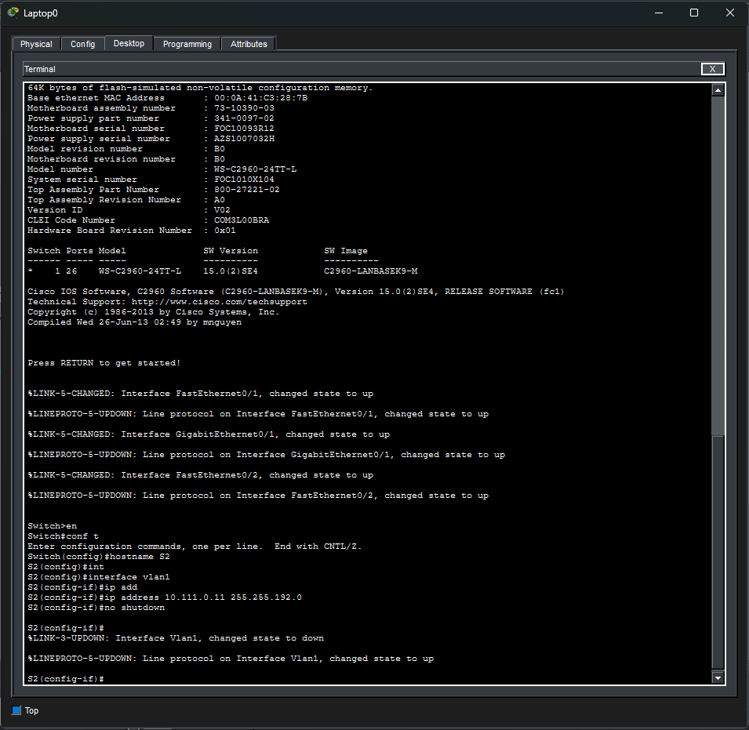
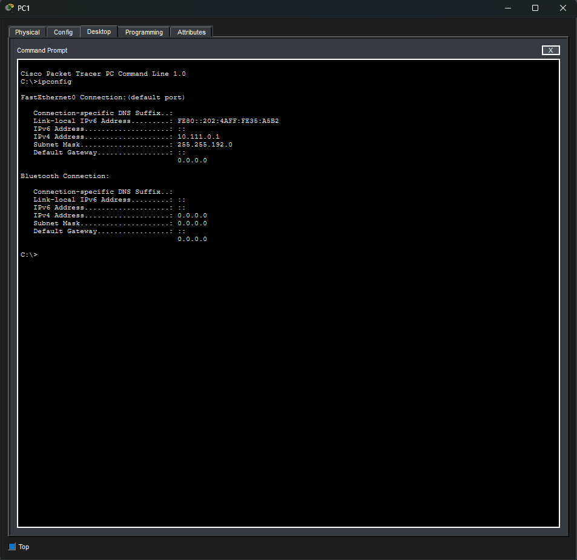
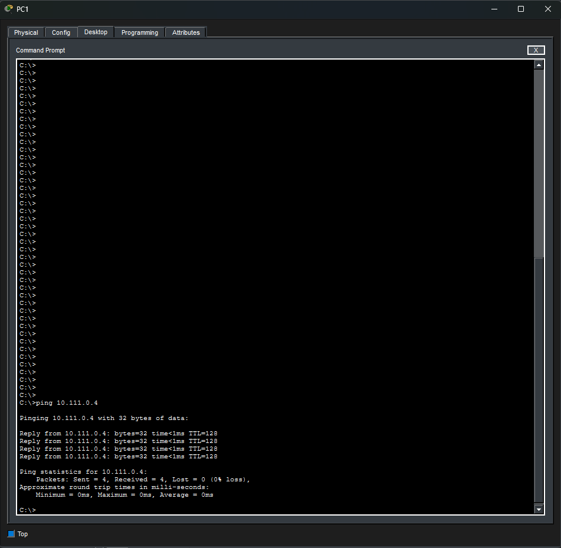
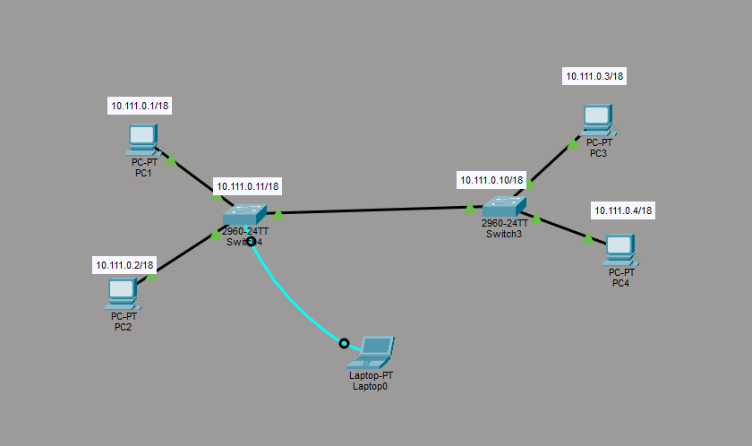

# 3ITe POS - PCK - Switch
Cílem projektu bylo vytvořit LAN síť se dvěma switchi a čtyřmi koncovými stanicemi, provést výpočet adresního rozsahu a nakonfigurovat zařízení pomocí konzolového terminálu.

## Výpočet rozsahu
Pro výpočet byly použity ordinální hodnoty (ASCII) písmen jména a příjmení bez diakritiky.
- **`10.X.0.0 / 16 + Y`**

### Výpočet X

**`Miklos`** M(77) + i(73) + k(107) + l(108) + o(111) s(115) = 623

623 modulo 256 = **111**

### Výpočet Y

**`Robert`** R(82) + o(111) + b(98) + e(101) + r(114) + t(116) = 662

662 modulo 10 = 2 **|** 16 + 2 = **18**

**`Rozsah = 10.111.0.0 / 18`**

## Snímky z CPT
### 1. Laptop - nastavování switche S2

### 2. PC1 - ipconfig

### 3. PC1 - ping na pc4

### 4. LAN

